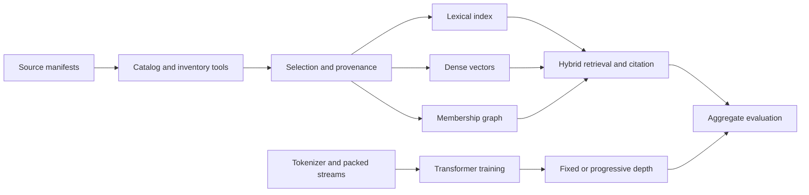
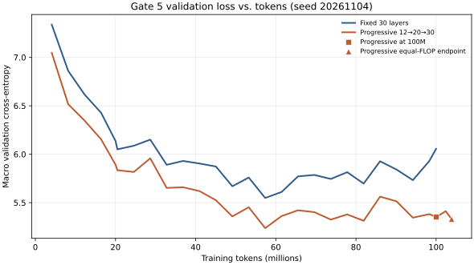
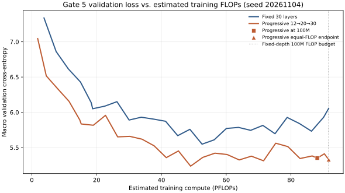

# Ancient Text Research

An ongoing engineering research prototype for cataloging heterogeneous ancient-text sources, retrieving passages with lexical, dense, and graph signals, and training a decoder-only language model across ancient languages. This repository demonstrates software and ML systems engineering. It does not release a corpus, dataset, tokenizer, or model.

## Engineering work completed

- Built catalog and raw-inventory utilities around deterministic manifests, checksums, and bounded parsing.
- Implemented hybrid retrieval with SQLite FTS5, dense-vector ranking, reciprocal-rank fusion, graph proximity, citation anchors, and retrieval evaluation.
- Implemented a configurable decoder-only Transformer, byte-level BPE tokenizer interface, data packing, training loop, and identity-preserving progressive depth growth.
- Benchmarked optimizer microbatch choices on CUDA and ROCm, and completed matched fixed-depth/progressive-depth training comparisons through 100M tokens.

## System overview



## Experimental results

The RAG pilot's reviewed results, the tokenizer/training summary, GPU comparison, and Gate 5 results are summarized in [RESULTS.md](RESULTS.md). These are experimental findings, not established general results. In particular, Gate 5's 100M comparison has one long-horizon seed and 32 validation batches per language; the fixed-depth Egyptian loss regression remains unexplained.





## Run synthetic demonstrations

See [SETUP.md](SETUP.md) for focused dependencies and CPU-only synthetic examples using the included retrieval and Transformer implementations:

```bash
python examples/retrieval_synthetic.py
python examples/cpu_transformer_step.py
```

The retrieval example runs lexical search and citation formatting. The training example performs one optimizer step with a small configuration of the real model; it does not run the corpus-streaming trainer.

## Limits and current status

This is an ongoing research prototype. Results depend on specific source selection, evaluation samples, hardware, and software versions. The retrieval graph encodes structural membership rather than validated semantic relations. Retrieval benchmark queries and labels, source texts, data exports, checkpoints, fitted tokenizers, embeddings, and databases are intentionally absent. The repository therefore cannot recreate full reported experiments without separately authorized inputs and artifacts.

The next step is a bounded larger training pilot led provisionally by progressive growth with a matched fixed-depth control. Broader seeds, language-specific regression analysis, independent replication, and stronger retrieval evaluation remain open work.

## Licensing and artifacts

Apache-2.0 applies only to original Python source files under `examples/`, `pretrain/`, `rag_pilot/`, `tests/`, and `tools/`. It does not license other repository files, including research documentation, aggregate-result figures, configurations, or any excluded corpus, dataset, tokenizer/model artifact, benchmark material, or third-party material. Third-party code dependencies and research attribution are listed in [THIRD_PARTY_NOTICES.md](THIRD_PARTY_NOTICES.md); dependencies retain their own licenses. Any future Hugging Face model or dataset release requires separate artifact-specific rights and licensing review.

See [CITATION.cff](CITATION.cff) for citation metadata.
